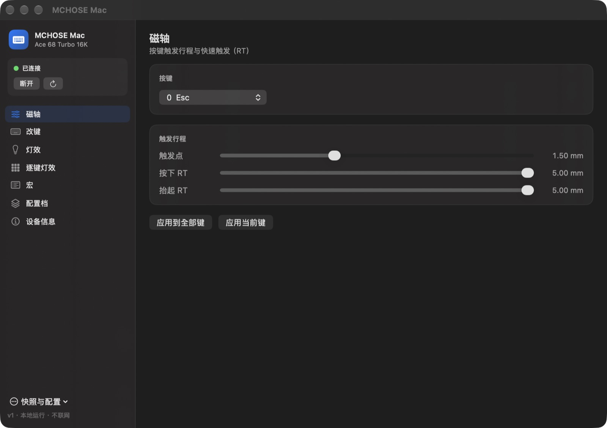
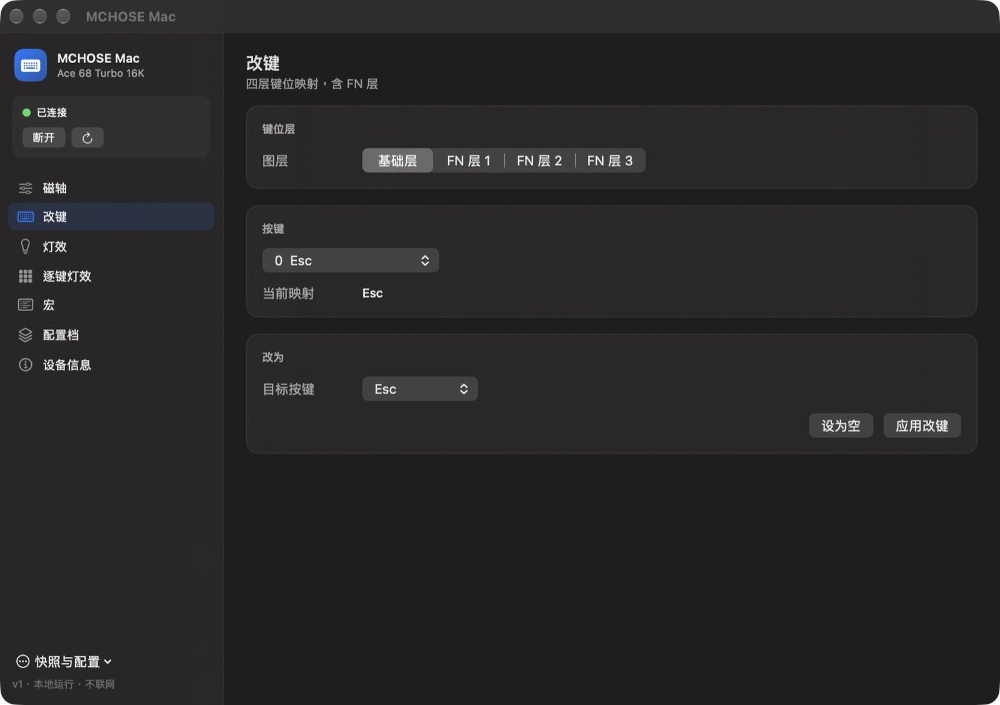
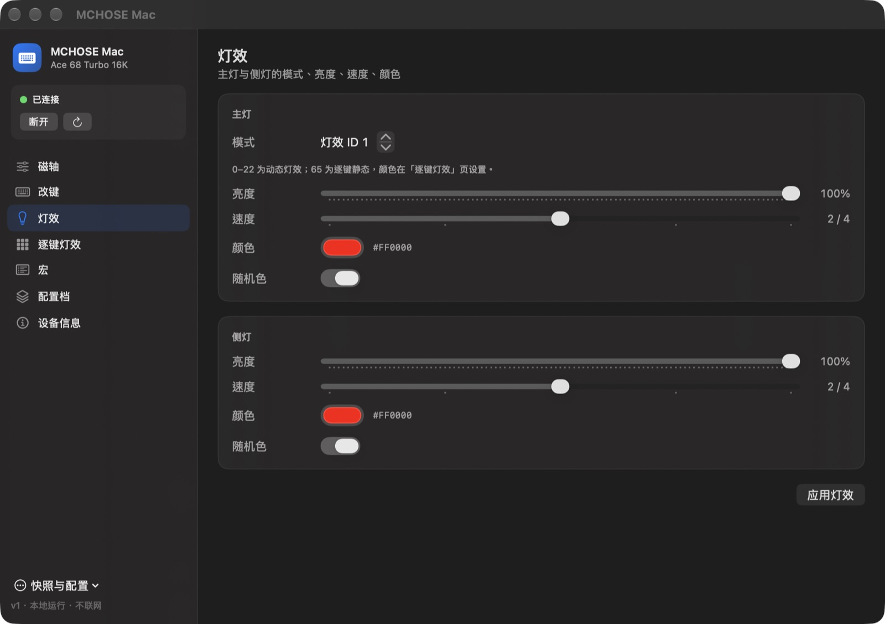
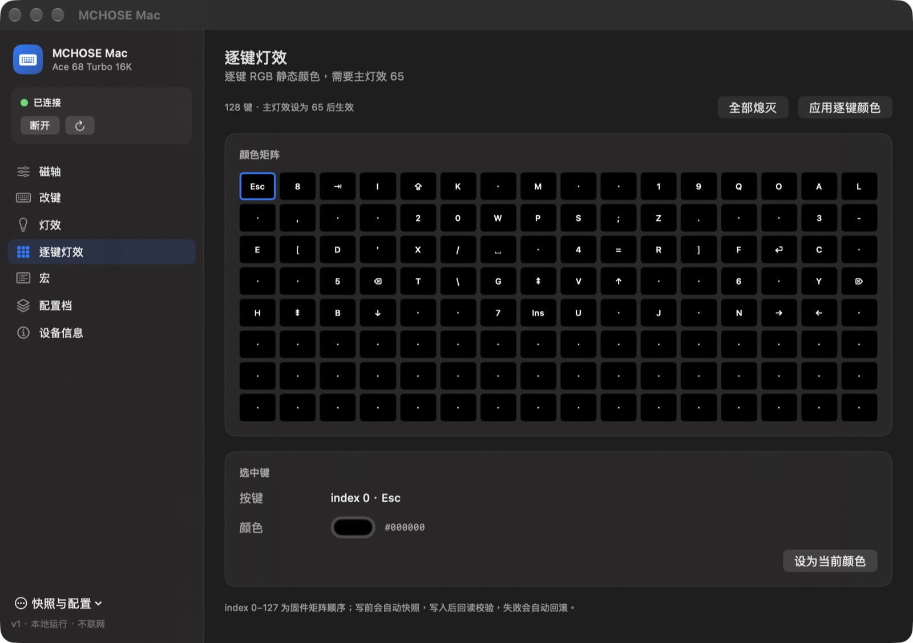
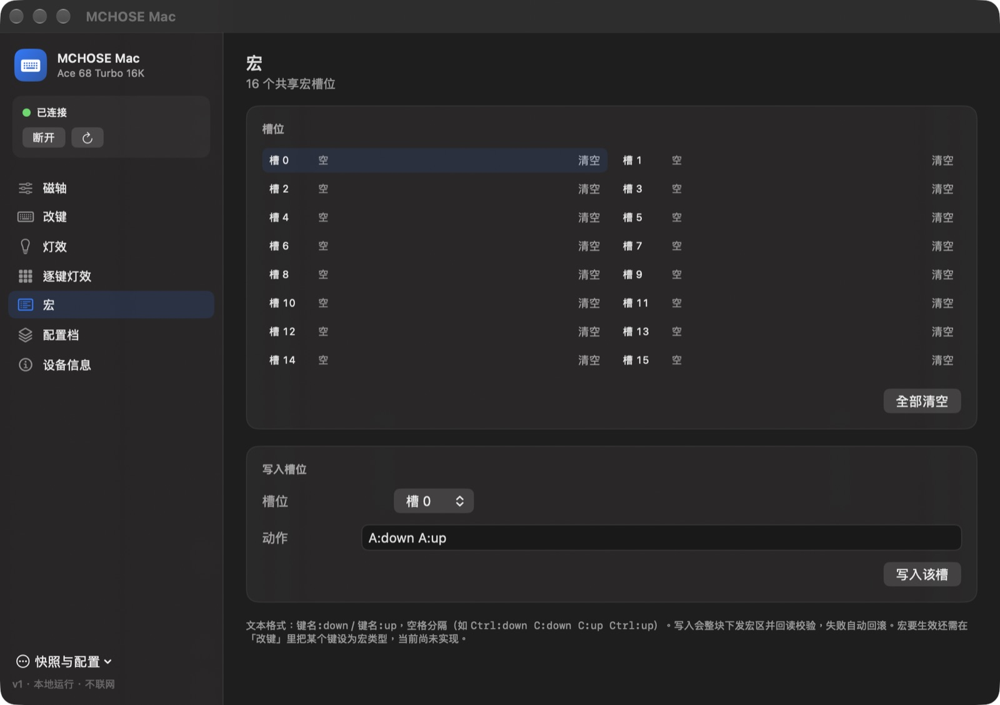
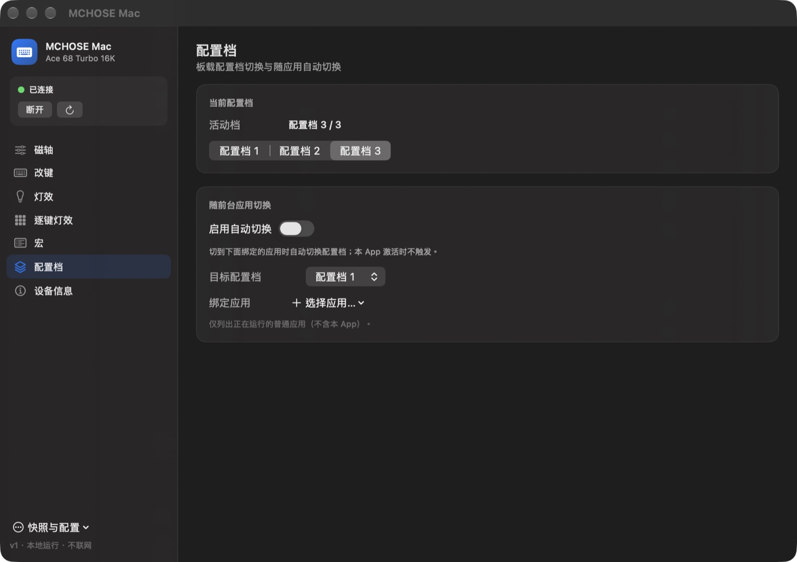

# MCHOSE Mac

macOS 原生的 **MCHOSE（迈从）Ace 68 Turbo 16K** 键盘配置工具。SwiftUI + IOKit 实现，直接打开厂商 HID 配置接口通信，运行时完全离线。

官方驱动是 Vue + WebHID 的网页应用，而 Safari 不支持 WebHID。本项目用 Swift 重写了常用配置能力，并额外加入**写入回读校验、自动回滚、配置快照**等安全机制。

A native macOS configurator for the MCHOSE Ace 68 Turbo 16K keyboard, built with SwiftUI and IOKit. It talks to the vendor HID configuration interface directly — no WebHID, no browser, no network.


## 截图

| 磁轴 | 改键 |
| --- | --- |
|  |  |

| 灯效 | 逐键 RGB |
| --- | --- |
|  |  |

| 宏 | 配置档 |
| --- | --- |
|  |  |

## 功能

目标设备：**MCHOSE Ace 68 Turbo 16K**（VID `0x3837` / PID `0x3026`，boot PID `0x3027`），测试固件版本 126。

| 功能 | 说明 |
| --- | --- |
| 设备识别 | 型号、固件版本、固件构建时间 |
| 磁轴 | 触发点、按下/抬起 RT、精度与死区，单键或全部键应用 |
| 多图层改键 | 4 层键位（含 FN 层）读写，FN 键位映射 |
| 灯效 | 主灯/侧灯的模式、亮度（0–100）、速度（0–4）、颜色、随机色 |
| 逐键 RGB | 128 键颜色读写，主灯效设为 65 时显示 |
| 配置档 | 3 个活动档切换、随前台应用自动切换（350 ms 去抖） |
| 宏 | 16 个共享宏槽的读取、写入、清空 |
| 快照与恢复 | 应用前自动快照，一键恢复；旧格式快照兼容 |
| 配置导入/导出 | JSON 格式 |
| 热插拔 | 配置接口增删、睡眠唤醒后自动重连 |
| 安全写入 | 每次写入回读校验，不一致自动回滚旧值 |

未实现（明确不在范围内）：SOCD、GIF、音乐律动、固件 OTA、boot 模式、多型号适配。

## 环境要求

- macOS 13 或更高
- Xcode 15+ / Swift 5.9+
- [XcodeGen](https://github.com/yonaskolb/XcodeGen)（仅构建 App 需要）
- 键盘处于有线连接状态

## 构建与运行

```bash
# 构建核心库 + 单元测试（70 个测试）
swift build
swift test

# 生成 Xcode 工程并构建 App（工程文件不入库，由 project.yml 生成）
xcodegen generate
xcodebuild -project MCHOSEMac.xcodeproj -target MCHOSEMac \
  -configuration Debug CODE_SIGNING_ALLOWED=NO build

open build/Debug/MCHOSEMac.app
```

调试时可用以下启动参数控制写权限：

```bash
# 只读：不发任何写命令
open build/Debug/MCHOSEMac.app --args --read-only

# dry-run：写入只编码、不发送
open build/Debug/MCHOSEMac.app --args --dry-run
```

> 在受限沙箱（如某些 AI agent 环境）中构建时，SwiftPM 自身的 sandbox 可能无法启动，可加 `--disable-sandbox`。

## CLI

除 App 外还带一个诊断/自动化 CLI，默认只读：

```text
mchose-cli <command> [options]

安全选项：
  --read-only    只发读命令（默认）
  --allow-write  允许写入
  --dry-run      只编码写入、不真正发送

命令：
  list                       枚举配置接口
  open                       打开配置接口
  watch [seconds]            监听热插拔事件（默认 5 秒）
  info <reportId-hex>        发送 getInfo 并打印响应
  probe                      读取信息 / 磁轴 / 键位 / 灯效 / 配置档
  layers                     读取并对比全部 4 层键位
  macro                      读取 16 个共享宏槽
  macro-set <slot> <a> ...   写入简单宏（如 A:down A:up）
  macro-clear [slot]         清空宏槽并回读校验
  keylight                   读取当前配置档的逐键 RGB
  keylight-set <i> <hex>     设置单键颜色并回读校验
  readraw <cmd> <off> <len>  读取任意命令的原始字节
  snapshot [path]            保存完整快照
  restore [path]             恢复最近/指定快照
  switchprofile <n>          切换配置档
  selfcheck                  走写入+回读校验路径并比对
```

```bash
swift run mchose-cli probe                  # 只读检查
swift run mchose-cli snapshot               # 写前快照
swift run mchose-cli layers                 # 四层键位差异
swift run mchose-cli keylight               # 逐键颜色
swift run mchose-cli selfcheck --allow-write
swift run mchose-cli restore --allow-write  # 恢复最近快照
```

## 安全模型

- **默认只读**：CLI 未指定 `--allow-write` 时不发送写命令；App 支持 `--read-only` / `--dry-run`。
- **写前快照**：每次应用设置前保存当前配置档的磁轴、4 层键位、逐键 RGB、宏区、func config、base 到 `~/Library/Application Support/MCHOSE Mac/Snapshots/`。
- **回读校验 + 回滚**：写入后立即回读比对，不一致时自动写回旧值并报错。
- **恢复校验**：快照记录来源配置档，恢复时逐段写入并校验。

## 架构

```text
App (SwiftUI + 菜单栏)
  └── DeviceStore（主线程状态 + 后台 I/O 调度）
        └── Features
              ├── DeviceConnection（连接、读写、校验、快照）
              ├── 磁轴 / 键位 / 灯效 / 宏 / 逐键 RGB 编解码
              └── Protocol（CZ 帧、分页组装、命令会话）
                    └── HIDTransport（IOKit 枚举、报告收发、热插拔、I/O 线程）
```

依赖方向：`App → Features → Protocol → HIDTransport`。

## 协议要点

- 所有读取都带逻辑地址：键位 `512 * (4 * profile + layer)`、磁轴 `1024 * profile`、func config/灯效 `64 * profile`、逐键灯效 `512 * profile + 3 * key`、base `0`。
- 宏区是各配置档共享的 8192 字节区域：读 `0x0C`、写 `0x0D`；64 字节 header（16 个 uint16 offset + `81 7E` + 16 个类型字节），动作 4 字节/步。
- 分页读取每页 offset 递增，响应回显 offset；写入分块与官方 SDK 一致（键位 54 字节/块，磁轴/配置 56 字节/块）。
- 灯效字段（亮度 0–100、速度 0–4、随机色标志）已对照官方 Web 驱动 bundle 与实机读取验证。

完整命令表、字节布局与实机验证记录见 [`docs/captures/ace68-feature-protocol.md`](docs/captures/ace68-feature-protocol.md)。

## 目录结构

```text
Sources/
  HIDTransport/   IOKit 枚举、配置接口、报告收发、热插拔监听、专用 I/O 线程
  Protocol/       CZ 协议编解码、分页组装、命令会话
  Features/       设备清单、磁轴、键位、灯效、配置档、宏、快照、连接封装
  MCHOSECLI/      诊断 CLI
App/Sources/      SwiftUI 应用（侧边栏窗口 + 菜单栏）
Resources/DeviceManifests/  设备清单 JSON
Tests/            单元测试（Swift Testing）
Tools/extract-manifest/     从官网 bundle 提取设备清单
docs/             设计文档、阶段计划、协议抓包与截图
```

## 已知限制

- 仅支持 Ace 68 Turbo 16K，其他型号未实机验证。
- 逐键 RGB 的 index 是固件矩阵顺序（0–127），尚未映射到物理键位坐标。
- 宏编辑器是最小实现：可读、清空、按文本写入单个槽；尚未支持把键位映射到宏，也不支持编辑每步延迟。
- SOCD 不在 macOS 版范围内：其协议依赖 report 77 的新 key config 通道，而本机 HID 接口不暴露该 report ID，探针无响应。
- 设备发现只枚举 MCHOSE 配置接口（`usagePage 1/0` 或 `0xFF00/1`），避免打开受保护键盘接口触发“输入监控”授权。
- App 设备 I/O 在专用 run-loop 线程执行，主线程只更新 UI；CLI 为单线程同步。
- 新构建首次运行可能因系统代码签名/TCC 校验多花 2–3 秒扫描。
- App 未签名、未公证，仅本地自用；自动切档会写 base（是否写 flash 待确认），已加去抖。

## 测试

```bash
swift test
# Protocol: 13 · HIDTransport: 19 · Features: 38，共 70 个测试
```

覆盖内容包括：CZ 编解码与分页组装、键位/灯效/宏/逐键 RGB 字节布局、快照兼容、设备清单匹配、I/O 线程顺序与超时。

## 文档

- [`docs/captures/ace68-phase0.md`](docs/captures/ace68-phase0.md) — 连接、打开接口、getInfo 抓包
- [`docs/captures/ace68-getinfo-fields.md`](docs/captures/ace68-getinfo-fields.md) — getInfo 字段映射
- [`docs/captures/ace68-feature-protocol.md`](docs/captures/ace68-feature-protocol.md) — CZ 帧、命令表、磁轴/键位/灯效/配置档编码
- [`docs/captures/ace68-macro-socd-perkeylight-protocol.md`](docs/captures/ace68-macro-socd-perkeylight-protocol.md) — 宏 / SOCD / 逐键灯效逆向记录
- [`docs/superpowers/specs/2026-10-18-mchose-mac-design.md`](docs/superpowers/specs/2026-10-18-mchose-mac-design.md) — 设计规格

## 免责声明

本项目与 MCHOSE 官方无关，仅用于个人设备的本地互操作。写设备有风险（配置丢失/异常），请先 `snapshot`。不实现 OTA，避免刷砖；不重新分发厂商素材或固件。

未附开源许可证；如需复用代码，请先联系作者。
